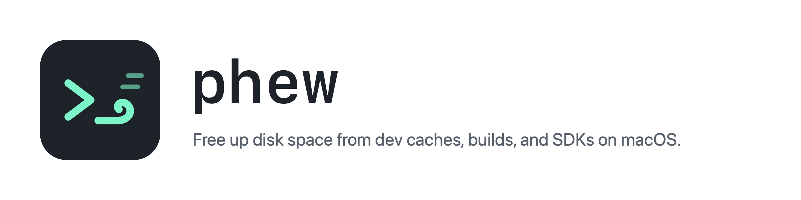

<picture>
  <source media="(prefers-color-scheme: dark)" srcset="docs/banner-dark.png">
  
</picture>

Phew is a menu bar app and CLI for macOS that frees disk space taken by developer files you can rebuild or download again: build output, package caches, SDK and toolchain versions, simulators and emulators, Docker data. It is for developers on any stack (Xcode, Android, Flutter, Node, Python, PHP and Laravel, WordPress, Ruby, Java, .NET, Go, Rust).

Phew has no telemetry. It never deletes anything without first showing the list of what goes, and it never prunes Docker volumes.

Screenshots coming.

## Install

1. Download `Phew-<version>.dmg` (or `.zip`) and its `.sha256` file from [Releases](https://github.com/dika-putra/phew/releases).
2. Check the download:
   ```bash
   shasum -a 256 -c Phew-<version>.dmg.sha256
   ```
3. Open the dmg and drag Phew to Applications. With the zip: unzip it and move `Phew.app` to `/Applications`.
4. Remove the quarantine flag. Phew is not signed with an Apple Developer ID, so macOS blocks it on first open without this:
   ```bash
   xattr -cr /Applications/Phew.app
   ```
5. Open Phew. It lives in the menu bar and has no Dock icon.

Requires macOS 14 or later.

### Build from source

Needs Xcode 16 or the Swift 6 toolchain.

```bash
git clone https://github.com/dika-putra/phew.git
cd phew
make app
open build/Phew.app
```

CLI only: `make install` copies `phew` to `~/.local/bin`.

## First run

- Click the menu bar icon. The first scan takes about a minute; later the popover opens with the last result right away and rescans every 2 hours in the background.
- Home shows free space, what Quick clean would free, and one row per group. Open a group to tick items and clean them.
- Add the folders that hold your projects in Settings > Project folders. Without them Phew only looks at global caches and tools.
- Full Disk Access is optional. Without it, folders macOS protects show "Needs Full Disk Access" and are left alone. Settings has a button that opens the right System Settings pane.
- Right-click the menu bar icon for Refresh, Settings and Quit.

## What it cleans

Each item has a tier:

- Regenerates: build output and caches that tools recreate on their own (DerivedData, `build`, `.next`, Go build cache).
- Redownload: package caches and SDKs that come back by downloading again (npm, Gradle, CocoaPods, `node_modules`, emulator images).
- Data loss: things you cannot get back (Xcode archives, emulator data). Never ticked by default; the confirmation says what is lost.

Groups: macOS, Xcode, Android, Flutter, Node, Python, PHP, Ruby, Java, .NET, Go, Rust, Homebrew, Editors, Docker, Versions, Projects, Extra folders.

Project folders are searched for these stacks: Flutter, Node, Rust, PHP, Laravel, WordPress, Python, CocoaPods, SwiftPM, Gradle, Maven, Ruby, .NET, Elixir, Terraform.

Quick clean takes the items that are ticked by default: Regenerates and Redownload items that are ready, not heavy, and not in a project you touched in the last 14 days. Untick an item to keep it out of Quick clean; Settings > Kept items lists those.

## Safety

- In use: items used by a running app (Xcode, Android Studio, Simulator), a dev server running in a project, or a Node version active in a terminal (`nvm use`) are skipped and the reason is shown.
- Versions: the default and active fvm, nvm and rustup versions are locked and never removed. "Used by" shows which projects pin a version.
- Projects: inside a git repository, only folders git ignores and that hold no tracked files are cleaned.
- Every clean shows a confirmation with each item, its tier and size. Deletes are permanent, not moved to the Trash.
- The receipt shows the space measured after deleting, not an estimate.
- Admin rights are only asked for the iOS simulator dyld cache, which root owns.

## CLI

Install it from Settings > Command line tool (links `~/.local/bin/phew` to the binary inside the app) or with `make install`.

```bash
phew scan                                   # measure, delete nothing
phew clean xcode.deriveddata --dry-run      # show the plan only
phew clean gradle dart.analysis             # clean after asking
phew list                                   # every target id
phew versions                               # fvm, nvm and rustup versions
phew config --add-root ~/Documents/Projects
```

`phew --help` and `phew help <command>` show every option with examples.

## Extra folders

For a cache Phew does not know, add it to `~/.config/phew/config.json`:

```json
{
  "customTargets": [
    {
      "id": "custom.myTool",
      "title": "My tool cache",
      "paths": ["~/.mytool/cache"],
      "tier": "regenerates"
    }
  ]
}
```

Rules: the id starts with `custom.`, paths start with `/` or `~/`, and protected folders are refused: your home folder itself, the top-level personal folders (Library, Documents, Desktop, Downloads, Pictures, Movies, Music, Applications), `~/.config`, `~/.ssh`, `~/.gnupg` and system folders. Tier is `regenerates`, `redownload` or `dataLoss`. Press Reload in Settings after editing. Invalid entries are skipped and listed in Settings.

## Known limitations

- Untested on Intel Macs. The release is a universal binary.
- Docker through colima, or OrbStack when it is stopped, shows as "off" and Start Docker does nothing.
- nvm installed with Homebrew, or nvm without a default alias, locks every Node version.
- The admin password prompt for the dyld cache closes after 10 minutes.

## Uninstall

1. Quit Phew (right-click the menu bar icon > Quit Phew) and turn off Launch at login in Settings first.
2. Delete `/Applications/Phew.app`.
3. Remove the CLI link and Phew's files:
   ```bash
   rm -f ~/.local/bin/phew
   rm -rf ~/.config/phew ~/Library/Caches/com.dikaputra.phew
   defaults delete com.dikaputra.phew
   ```

## Credits

Part of the cache path list comes from [PureMac](https://github.com/momenbasel/PureMac) (MIT). The menu bar layout took ideas from [mac-cleaner-cli](https://github.com/guhcostan/mac-cleaner-cli) (MIT). See [NOTICE](NOTICE).

## License

MIT. See [LICENSE](LICENSE).
